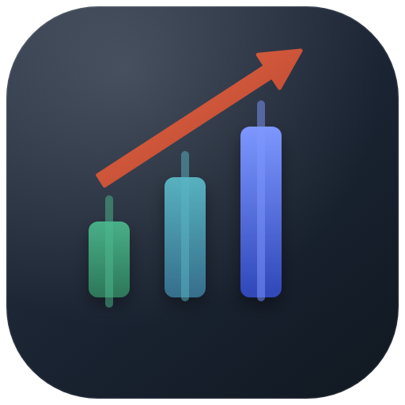
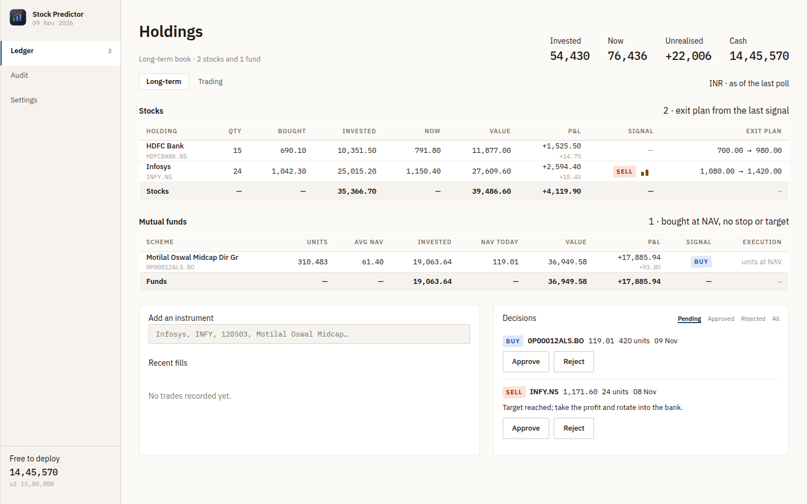

<p align="center">
  
</p>

<h1 align="center">Stock Predictor</h1>

<p align="center">
  <a href="https://github.com/manmohangurram/stock-predictor/actions/workflows/ci.yml"></a>
  <a href="https://github.com/manmohangurram/stock-predictor/actions/workflows/docker-publish.yml"></a>
  <a href="https://github.com/manmohangurram/stock-predictor/blob/main/LICENSE"></a>
  <a href="https://github.com/manmohangurram/stock-predictor/tags"></a>
  <a href="https://github.com/manmohangurram/stock-predictor/pkgs/container/stock-predictor"></a>
</p>

**Stock Predictor** is a self-hosted portfolio ledger for Indian markets. It watches what you hold,
suggests buy and sell decisions with a full exit plan, and pushes **one notification** when
something actually needs doing — a stop breached, a target reached, or a new entry worth the money.

It is not a price oracle. The engine is a deterministic strategy plus a language model's judgement on
the news, and every number it suggests is validated against your cash, your limits and the price band
before you see it.



### Trying prompts locally

Copy `.env.example` to `.env` (gitignored) and put a key in it:

```sh
DEEPSEEK_API_KEY=sk-...
```

The server reads `.env` at start-up. A key stored in Settings wins over this one, and nothing
from `.env` is ever written into the database — it exists so a prompt can be run against a
real model without keeping a key at rest. Development convenience, not a deployment variable.

## Current Features

- **Three monthly allowances, not ceilings.** Long-term stocks, mutual funds and the short-term book
  each get their own purse — granted on the 1st, expiring at month end, and never sharing money: the
  fund purse cannot buy a stock and a leftover does not top up another pot — recorded as its own ledger kind, never as a trading loss. Raising the
  allowance mid-month tops the pot up; lowering it claws the unspent part back.
- **Decisions need your say-so.** Every suggestion is `pending` until you approve it — with the fill
  you actually got, quantity and price editable — or reject it with a reason. The ledger shows what
  is still under review; approved and rejected live behind a filter.
- **Rotation.** When a buy is right but the cash is gone, the model may propose a swap: sell
  something in profit to fund it. One decision with two legs, approved or refused as a unit, and a
  swap that does not balance is refused before any money moves.
- **The model sees the book, not one stock.** Every prompt carries the holdings and a plain sentence
  saying what the purse can spend, and once a poll a book call may propose up to three **stock**
  moves that stand or fall together — sell one holding to fund another, approved as one plan.
  Mutual funds are not part of a plan: their own daily scan picks them, from their own purse.
- **Two pots, one process.** Long-term and trading books with separate capital, separate limits and
  separate history. Neither can starve the other; the same stock can sit in both.
- **Stocks and mutual funds, handled as what they are.** Funds are bought at NAV and held — no
  intraday exit exists, so they cannot be filled into the short-term pot, and their table has its own
  columns.
- **Buy *and* sell.** A breached stop or a reached target is a SELL signal and a high-priority push
  on the very next poll. The model may explain that, never talk the app out of it.
- **Every suggestion is checked** against available cash, per-trade caps, one-instrument exposure,
  the profit band, ATR distance, stop side and positions actually held. A proposal that fails becomes
  `BLOCKED`, never silently resized.
- **Honest about silence.** A quiet instrument says why it is quiet — "rules see no entry (trend —
  close below SMA200)", "no key configured", "called 12 minutes ago".
- **One notification per actionable change**, deduplicated, with a deep link back to the ledger.
- **Cheap to run.** The model is called only when the price moved or the headlines changed — never
  just because time passed — and Audit records the exact reason for every call next to what you did
  with the decision it produced. The static prompt block is a cacheable prefix.
- **Best-fund discovery.** Once a day, a curated list of large equity funds is ranked by their
  trailing return (3-year, falling back to 1-year) and the top names are proposed against the
  mutual-fund earmark. A fund is a six-month-plus commitment, so the scan runs once a day, not on a
  tick.
- **Short-term discovery.** NSE's daily movers (top ten across all securities) are checked on every
  tick; each name is asked about only when *it* changed, and the answer is a short-term decision with
  a horizon and an expiry no longer than a week — and the pass sends **one push per batch**, listing
  the names with entry, stop and target, so you hear about them without opening the app.
- **Everything is a settings row** — budget, limits, model and key, ntfy, polling cadence and an
  HTTP proxy — edited in the UI and applied on the next tick. Three environment variables remain.
- **Auditable.** Every outbound call stores its prompt and its raw reply; the Audit page renders the
  exchange as it happened.
- **Removable.** An instrument you never traded is deleted with its bars; one with fills is archived
  so its history survives; one you still hold is refused until it is sold.

## How it decides

```
                ┌───────────── poll every 15 min (2 h after the close) ─────────────┐
Yahoo Finance ──┤ prices, daily bars, intraday tape, headlines                      │
AMFI (India) ───┤ mutual fund NAV                                                │
                └────────────────────────┬──────────────────────────────────────────┘
                                         ▼
                            rules layer (trend, RSI, ATR, budget)
                                         │ candidate or "nothing here"
                                         ▼
                            DeepSeek: decide / ask for an article / pass
                                         │  one escalation, ≤3 articles, ≤7 days
                                         ▼
                            validator: ATR band, stop side, cash, holdings,
                                       profit expectation, citations
                                         ▼
                          ledger row + one ntfy push (deduplicated)
```

Long version, including why the two pots are separate: [`docs/how-it-works.md`](docs/how-it-works.md).

## Getting Started

```yaml
services:
  stock-predictor:
    image: ghcr.io/manmohangurram/stock-predictor:latest
    container_name: stock-predictor
    restart: unless-stopped
    ports:
      - "${PORT:-8080}:8080"
    environment:
      PUBLIC_URL: ${PUBLIC_URL:-}
      SECRET_KEY: ${SECRET_KEY:?set SECRET_KEY in .env — openssl rand -hex 32}
      RUST_LOG: ${RUST_LOG:-info}
      TZ: ${TZ:-Asia/Kolkata}
    volumes:
      - ${DATA_DIR:-./data}:/data
```

```bash
cp .env.example .env      # then put an `openssl rand -hex 32` in SECRET_KEY
docker compose up -d
open http://localhost:8080
```

First run: set the budget on **Settings → Money**, add instruments from the ledger's search box, and
record what you already hold. The image is multi-arch (`linux/amd64`, `linux/arm64`) and is published
only from a `v*` tag.

Docker, Compose, a systemd unit, backups and the container's `/data` uid edge case:
[`docs/deployment.md`](docs/deployment.md).

## Configuration

Three environment variables, and nothing else:

| Variable | Default | Meaning |
|---|---|---|
| `BIND` | `127.0.0.1:8080` | Listen address; the image sets `0.0.0.0:8080` |
| `DB_PATH` | `data/stock-predictor.db` | The SQLite file; the image sets `/data/stock-predictor.db` |
| `PUBLIC_URL` | *(empty)* | The address you reach it at, for the deep link on a notification |
| `SECRET_KEY` | *(key file)* | 32 bytes that encrypt the stored secrets: `openssl rand -hex 32` |

Budget, currency, the two pots' limits, the model provider and its key, ntfy, the polling cadence and
the proxy are **settings rows edited in the UI**, applied on the next tick. Provider keys, the ntfy
token and the proxy password are encrypted at rest.

Full reference — every setting, the proxy, the secrets, the risk limits, the provider table:
[`docs/configuration.md`](docs/configuration.md). Every endpoint, and which the UI uses:
[`docs/api.md`](docs/api.md).

## Development

```bash
cargo test                       # no test touches the network
cargo clippy --all-targets       # must be warning-free
cargo bench --bench hot_paths    # indicators, prompt render, bar upsert
cd web && npx vitest run && npm run build
```

Spec and plan live in [`docs/superpowers/`](docs/superpowers/), the design system in
[`.interface-design/system.md`](.interface-design/system.md).

## Support

- Bug reports and feature requests: [GitHub Issues](https://github.com/manmohangurram/stock-predictor/issues)
- Before asking: the [configuration reference](docs/configuration.md) and
  [deployment notes](docs/deployment.md) cover most of it.

## Security

There is **no authentication**, by design: this is a single-user home tool. Bind it to your LAN or a
VPN, never port-forward it, and treat the ntfy topic as a secret. Secrets are encrypted at rest, which
protects a copied database — not a machine. The full note is in
[`docs/deployment.md`](docs/deployment.md#security).

## Limitations worth knowing

- **Indian markets only.** NSE/BSE via Yahoo, mutual fund NAV via AMFI. The session window is IST.
- **Yahoo and AMFI are unofficial.** A shape change breaks the fetch; the parsers fail loudly rather
  than inventing a number.
- **The short-term pot gets no recommendations of its own** — it accepts the fills you record. A swing
  strategy is not built.
- **No stop-loss automation.** The app never trades; it tells you what it would do.
- **One process, one SQLite file.** No clustering, no read replicas. That is the point.

## Licence

Apache 2.0 — see [LICENSE](LICENSE).
