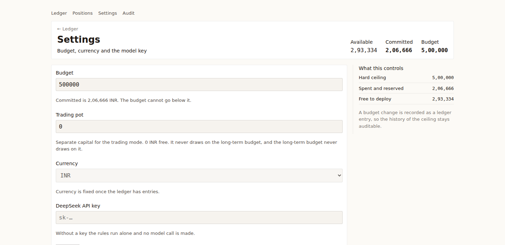

# stock-predicter

A self-hosted portfolio ledger that watches your holdings, suggests buy and sell decisions with
prices and an exit plan, and pushes one notification when something actually needs doing.

It is **not** a price oracle. The engine is a deterministic strategy plus a language model's
judgement on the news, and every number it suggests is validated before you see it.

```
                ┌───────────── poll every 15 min (2 h after the close) ─────────────┐
Yahoo Finance ──┤ prices, daily bars, intraday tape, headlines                      │
AMFI (India) ───┤ mutual fund NAV                                                │
                └────────────────────────┬──────────────────────────────────────────┘
                                         ▼
                            rules layer (trend, RSI, ATR, budget)
                                         │ candidate or "nothing here"
                                         ▼
                            DeepSeek: decide / ask for an article / pass
                                         │  one escalation, ≤3 articles, ≤7 days
                                         ▼
                            validator: ATR band, stop side, cash, holdings,
                                       profit expectation, citations
                                         ▼
                          ledger row + one ntfy push (deduplicated)
```

## What it does

- **Tracks a real portfolio** across stocks, mutual funds and IPO applications, with two
  independent pots (long-term and trading) that never draw on each other.
- **Keeps a permanent record**: every buy and sell is a row in `trades`, with the market close on
  the day of the fill, and realised profit/loss computed at sale time. Older fills can be
  backdated.
- **Suggests decisions with an exit plan.** A buy must carry both a stop and a take-profit, or it
  is discarded. Every decision shows money at risk, risk per unit and reward:risk, computed from
  the validated levels rather than reported by the model.
- **Respects your budget.** Spend is capped by the ledger; a signal that would overspend is
  recorded as `BLOCKED` with the shortfall and never pushes a notification.
- **Knows its own limits.** A per-stock *profit expectation* (say 15%) is passed into the prompt,
  and a take-profit below it is rejected.
- **Explains silence.** Each instrument page shows which rule blocked a trade and with what
  numbers, so an empty ledger is never a mystery.
- **Costs little.** The model is only called when the price moved ₹2, when a new headline
  arrived, or once an hour; the static prompt block is a cacheable prefix.

## Screens

**Ledger** — the portfolio strip, holdings with their latest signal, search-and-add, recent fills.


**Instrument** — price history with both moving averages, a fill recorder, the decision stream,
the full fills history, headlines, and the rule checklist that explains why a signal fired or
did not.


**Trading pot** — the same instrument set, a separate budget, a separate book.


**Settings** — budget, currency, the second pot, and the DeepSeek key (write-only; it is never
returned by the API).



## Quick start

Requires Rust 1.85+ and Node 22+.

```bash
cd web && npm ci && npm run build && cd ..
cargo build --release

BUDGET=500000 CURRENCY=INR ./target/release/stock-predicter
```

Then open <http://127.0.0.1:8080>, and on **Settings**:

1. set the budget (it is seeded from `BUDGET` on first boot and owned by the database after
   that),
2. paste a DeepSeek API key if you want the model layer (without one the rules run alone and no
   call is ever made),
3. add instruments by searching — `INFY`, `Wipro`, `axis elss`. Stocks come from Yahoo, mutual
   funds from AMFI's daily file.

`cargo run -- --seed` fills a demo portfolio at live prices; `--poll-once` runs one cycle
outside market hours; `--ask SYMBOL` asks the model about one instrument and writes nothing.

## Configuration

Everything is optional except where noted. The database holds the budget, the currency and the
API key after first boot; the environment only seeds them.

| Variable | Default | Meaning |
|---|---|---|
| `BUDGET`, `CURRENCY` | `0`, `INR` | First-boot seed for the long-term pot |
| `DEEPSEEK_API_KEY` | empty | Can be set in Settings instead |
| `NTFY_TOPIC`, `NTFY_BASE_URL` | empty, `https://ntfy.sh` | Push channel; empty means none |
| `DB_PATH` | `data/stock-predicter.db` | SQLite file; the directory is created |
| `BIND` | `127.0.0.1:8080` | Listen address (use `0.0.0.0:8080` in Docker) |
| `POLL_SECS` | `900` | In-session cadence |
| `OFF_HOURS_SECS` | `7200` | Cadence outside 09:00–16:00 IST |
| `PROMPT_WINDOW_HOURS` | `4` | Hours of intraday tape per prompt (biggest token lever) |
| `LLM_MIN_PRICE_MOVE` | `2.0` | Skip a call unless the price moved this much |
| `LLM_MAX_SILENCE_SECS` | `3600` | ...but never stay quiet longer than this |
| `LLM_DAILY_CAP` | `200` | Hard ceiling on model calls per day |

## Self-hosting with Docker

Build and run:

```bash
docker build -t stock-predicter .
docker run -d --name stock-predicter \
  -p 8080:8080 \
  -v "$PWD/data:/data" \
  -e BUDGET=500000 -e CURRENCY=INR \
  -e NTFY_TOPIC=your-private-topic \
  stock-predicter
```

Or with Compose, which is the same thing in a file:

```bash
docker compose up -d --build
```

A published multi-arch image is built on every `v*` tag:

```bash
docker run -d --name stock-predicter -p 8080:8080 -v "$PWD/data:/data" \
  ghcr.io/manmohangurram/stock-predictor:latest
```

**Back up the whole `data` directory**, not just the `.db` file — SQLite in WAL mode keeps recent
commits in `-wal` beside it.

> **Security.** There is no authentication, by design: this is a single-user home tool.
> It binds to `127.0.0.1` locally and to the container's network in Docker. Put it on a trusted
> LAN or behind a VPN, never port-forward it to the internet, and treat the ntfy topic name as a
> secret. The DeepSeek key is stored in plaintext in the database.

## Development

```bash
cargo test                          # no test touches the network
cargo clippy --all-targets          # must be warning-free
cargo bench --bench hot_paths       # indicators, prompt render, bar upsert
cd web && npx vitest run && npm run build
```

The live model checks are opt-in and cost money:

```bash
DEEPSEEK_API_KEY=sk-... cargo test --test live_deepseek -- --ignored --nocapture
```

Design and plan live in `docs/superpowers/specs/` and `docs/superpowers/plans/`; the interface
system is `.interface-design/system.md`. `AGENTS.md` records the working agreements and the
performance budgets.

## Limitations worth knowing

- Yahoo Finance has no official API. Endpoints and shapes change without notice; all access goes
  through `src/market/yahoo.rs` so there is one place to fix.
- Headline coverage is uneven: Yahoo returns nothing at all for some NSE names, and those
  instruments are decided on prices alone.
- Mutual funds have no intraday price. They trade at NAV; cash arrives T+1/T+2.
- Cost basis is weighted-average, so a backdated buy restates the average used for later
  realised profit. FIFO lot accounting is the upgrade path.
- The trading mode's discovery (scanned candidates) is not built yet; both pots currently work
  from instruments you add yourself.
- Nothing places orders. Every suggestion is yours to execute at your broker.

## Licence

MIT, see [LICENSE](LICENSE).
